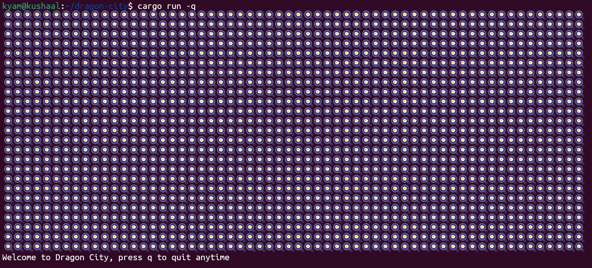

# Dragon City

![Static Badge](https://img.shields.io/badge/Dragon_City-Alpha-yellow?logo=data:image/svg%2bxml;base64,PHN2ZyB4bWxucz0iaHR0cDovL3d3dy53My5vcmcvMjAwMC9zdmciIHZpZXdCb3g9IjAgMCA2NCA2NCI+DQogIDxwYXRoDQogICAgZD0iTTMyIDQNCiAgICAgICBDMjAgNCAxMCAyNSAxMCA0MQ0KICAgICAgIEMxMCA1MyAxOSA2MCAzMiA2MA0KICAgICAgIEM0NSA2MCA1NCA1MyA1NCA0MQ0KICAgICAgIEM1NCAyNSA0NCA0IDMyIDRaIg0KICAgIGZpbGw9IiNGRkQ5MkYiDQogICAgc3Ryb2tlPSIjNkIzQjEyIg0KICAgIHN0cm9rZS13aWR0aD0iMyINCiAgICBzdHJva2UtbGluZWpvaW49InJvdW5kIg0KICAvPg0KDQogIDxnIGZpbGw9IiNGMjhDMTYiIHN0cm9rZT0iIzZCM0IxMiINCiAgICAgc3Ryb2tlLXdpZHRoPSIxLjUiIHN0cm9rZS1saW5lam9pbj0icm91bmQiPg0KICAgIDxwYXRoIGQ9Ik0xNyAyOCBMMjQgMjMgTDI5IDI5IEwyMyAzNVoiLz4NCiAgICA8cGF0aCBkPSJNMzUgMTggTDQyIDIzIEwzOCAzMCBMMzIgMjVaIi8+DQogICAgPHBhdGggZD0iTTM5IDM1IEw0NyAzMSBMNDkgMzkgTDQzIDQ0WiIvPg0KICAgIDxwYXRoIGQ9Ik0yMCA0MiBMMjcgMzcgTDMzIDQzIEwyNyA0OVoiLz4NCiAgICA8cGF0aCBkPSJNMzQgNDkgTDQwIDQzIEw0NiA0OCBMNDEgNTRaIi8+DQogIDwvZz4NCg0KICA8cGF0aA0KICAgIGQ9Ik0zMCA0IEwzNCAxMyBMMjkgMTkgTDM1IDI1Ig0KICAgIGZpbGw9Im5vbmUiDQogICAgc3Ryb2tlPSIjNkIzQjEyIg0KICAgIHN0cm9rZS13aWR0aD0iMi41Ig0KICAgIHN0cm9rZS1saW5lY2FwPSJyb3VuZCINCiAgICBzdHJva2UtbGluZWpvaW49InJvdW5kIg0KICAvPg0KDQogIDxwYXRoDQogICAgZD0iTTE4IDQ5IFEyMSA1NSAyOCA1NiINCiAgICBmaWxsPSJub25lIg0KICAgIHN0cm9rZT0iI0ZGRjJBMCINCiAgICBzdHJva2Utd2lkdGg9IjIiDQogICAgc3Ryb2tlLWxpbmVjYXA9InJvdW5kIg0KICAvPg0KPC9zdmc+&style=plastic)




A Rust-based CLI recreation of Dragon City.

**Status:** Super Early development (Alpha)

## Features

- Terminal-based city display
- Keyboard input with raw terminal mode
- Fixed-size city grid
- Quit the game by pressing `q`

## Requirements

- Rust and Cargo
- Git
- This is Linux only by the way
- Guys, Please dont try to run this on ordinary windows, Use Git Bash or MYSYS

## Running

Run:

```bash
git clone https://github.com/its-kyam/dragon-city.git
cargo run -q
```

`-q` will make cargo not show build messages.

## Fun

Change the help message in constants.rs to anything, Also you can Change the emoji in constants.rs to a '🐉'.

## Development

This project is under active development. Many Things may change.

If you want to contribute, 

## Disclaimer

This is an unofficial fan project and is not affiliated with or endorsed by Socialpoint or the original Dragon City game's publishers.

## License

Dragon City is licensed under the GNU General Public
License v3.0 or any later version (GPL-3.0-or-later).
See [LICENSE](LICENSE) for the full license text.
